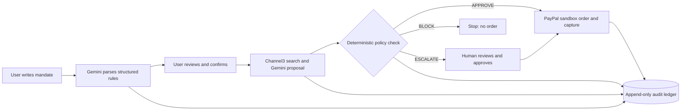
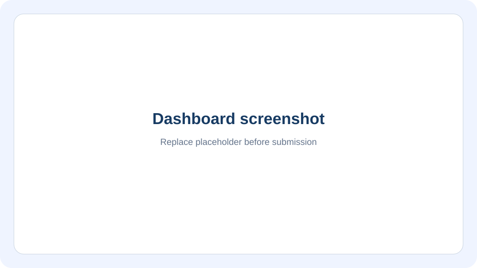
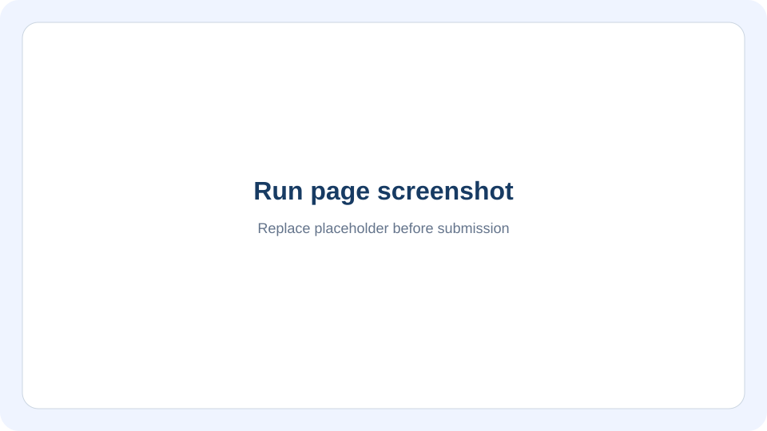
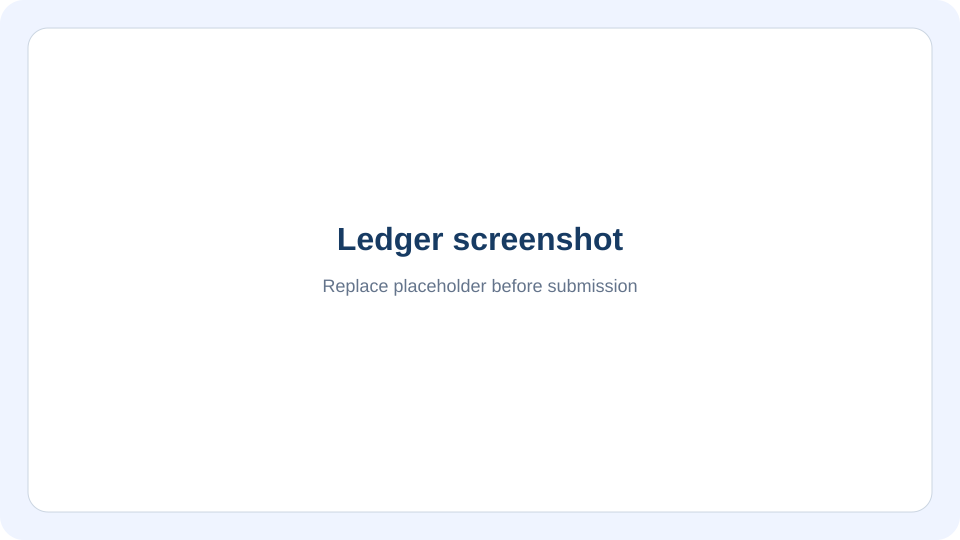

# Mandate

Mandate lets a person delegate a shopping task without handing an AI unrestricted spending authority. Write the purchase rules in plain English; the app turns them into a mandate, searches real catalog offers, and proposes a cart. Deterministic code checks the merchant, category, price, budget, returns and delivery rules before any PayPal sandbox checkout.

The problem it addresses is simple: a shopping agent can misunderstand a request, follow malicious product text, or exceed a budget. Mandate treats the model as a proposer. Only server policy can approve, escalate for a human, or block a purchase.

## How a purchase flows



## Trust model

- Gemini proposes structured mandate fields and a product selection. Zod validates model output; server-owned mandate identity, status and expiry cannot be set by the model.
- Product names and descriptions are untrusted. Price, currency, merchant, category, and stock status come from structured Channel3 offers. Checkout re-fetches the selected merchant's current price.
- The policy engine is deterministic code, with no LLM or network calls. It recomputes totals from integer cents, checks mandate state and spend caps, and gives BLOCK priority over human approval.
- Unknown required return or delivery data escalates to a person. A human approval cannot override a BLOCK on checkout re-check.
- A reserved spend hold stays in the append-only ledger if the payment result is uncertain; it is released only after a definitive PayPal 4xx rejection. PayPal is sandbox only.

## Judge the build

Hosted demo: **`https://<your-render-host>.onrender.com`**. Replace this placeholder with the active Render URL before submission. The demo passcode is in the Devpost testing instructions; no passcode is stored in this repository. See [docs/JUDGES.md](docs/JUDGES.md) for a five-minute walkthrough.

### Evals

The offline evals exercise the real policy, search, checkout, parser, accounting and replay paths with network dependencies faked. The parallel checkout case needs a local `DATABASE_URL_TEST` and is skipped otherwise.

| Eval group | Result |
| --- | --- |
| Offline policy, prompt-injection, search, checkout, replay and parser cases | 27 PASS |
| Parallel guarded checkouts against test Postgres | SKIPPED (`DATABASE_URL_TEST` unset in the recorded run) |
| Live Gemini injection evals | Not run; opt-in only |

Mutation check: deliberately changing the total cap, removing the per-item cap, and approving unknown required returns made the corresponding exact-cap, over-cap, and returns-injection evals fail. Restoring the policy returned the offline suite to green. Full results: [evals/RESULTS.md](evals/RESULTS.md); mutation details: [docs/NOTES.md](docs/NOTES.md#evals-have-teeth).

### How it's tested

GitHub Actions runs Node.js 22, lint, typecheck, tests and offline evals on every push. Run the same checks locally with `npm run lint`, `npm run typecheck`, `npm test` and `npm run evals`. Live Gemini evals are opt-in: `npm run evals -- --live`.

Database integration tests use `DATABASE_URL_TEST` only, reject non-loopback hosts, and skip when it is unset. To run them against a disposable local Docker Postgres:

```powershell
docker run --name mandate-test-db -e POSTGRES_HOST_AUTH_METHOD=trust -e POSTGRES_DB=mandate_test -p 5433:5432 -d postgres:16
$env:DATABASE_URL_TEST = "postgres://postgres@localhost:5433/mandate_test"
$env:DATABASE_URL = $env:DATABASE_URL_TEST
npm run db:migrate
npm test
Remove-Item Env:DATABASE_URL, Env:DATABASE_URL_TEST
docker rm -f mandate-test-db
```

To smoke-check a deployment, set `DEMO_PASSCODE` locally and run `npm run smoke -- https://<deployed-host>`. The optional `--run` creates a permanent throwaway mandate and starts a real shopping run; it can trigger a sandbox purchase up to $3 if approved.

## Tools used

| Tool | How Mandate uses it |
| --- | --- |
| PayPal Orders v2 | Creates buyer-approved orders and captures approved purchases in the PayPal sandbox. |
| PayPal Vault payment tokens | Links a sandbox PayPal wallet for saved-wallet checkout; token IDs remain server-side. |
| Gemini structured output | Parses natural-language mandates and ranks catalog candidates into schema-validated JSON. |
| Channel3 search | Finds products and live USD merchant offers for the requested query. |
| Channel3 product lookup | Re-fetches the selected product and merchant price before checkout. |
| Channel3 categories | Supplies validated category slugs for mandate category rules. Channel3 does not provide return-policy or delivery estimates used by this app. |
| Render | Hosts the Next.js web service and managed PostgreSQL database; migrations run during build. |
| AG Grid Community | Displays append-only ledger events with sorting, filtering, pagination and CSV audit export. |

## Screenshots

These are replacement markers. Capture the real hosted UI before submission and replace the images in `docs/screenshots/`.

| Dashboard | Run | Approval | Ledger |
| --- | --- | --- | --- |
|  |  |  |  |

## Setup

Requires Node.js 22+, npm, and a PostgreSQL database. Add the API credentials described in `.env.example`; PayPal must be configured for sandbox.

```bash
npm install
cp .env.example .env
# Fill in .env (never commit it)
npm run db:migrate
npm run dev
```

Open `http://localhost:3000`. Set `DEMO_PASSCODE` in `.env` and use it at `/enter`.

## Honest limits

- PayPal is sandbox only. No real funds move.
- Fulfillment is simulated: the app can create or capture a sandbox payment, but it does not place or fulfill a retailer's order.
- Channel3 catalog data does not include return-policy or delivery estimates. A mandate requiring either fact escalates to a human because the app cannot verify it.
- The default Render hosting tiers can cold-start or be slow on the first request. Allow about a minute for the first dashboard or run page load.
- The demo has one shared passcode, not per-user accounts. The ledger is append-only and test charges that have no mandate are shown separately.

## License

MIT. See [LICENSE](LICENSE).
